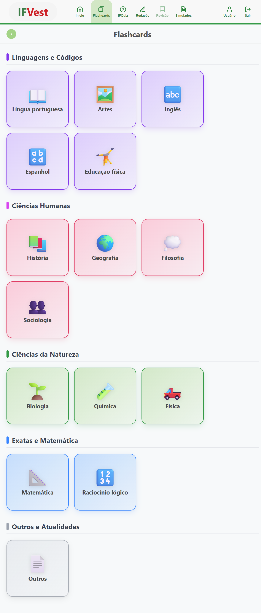
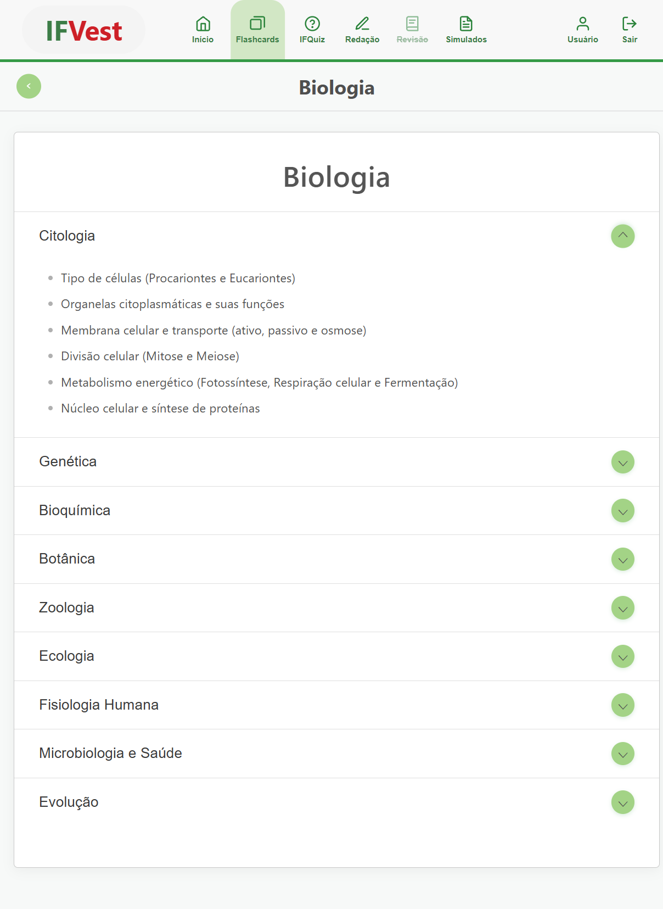
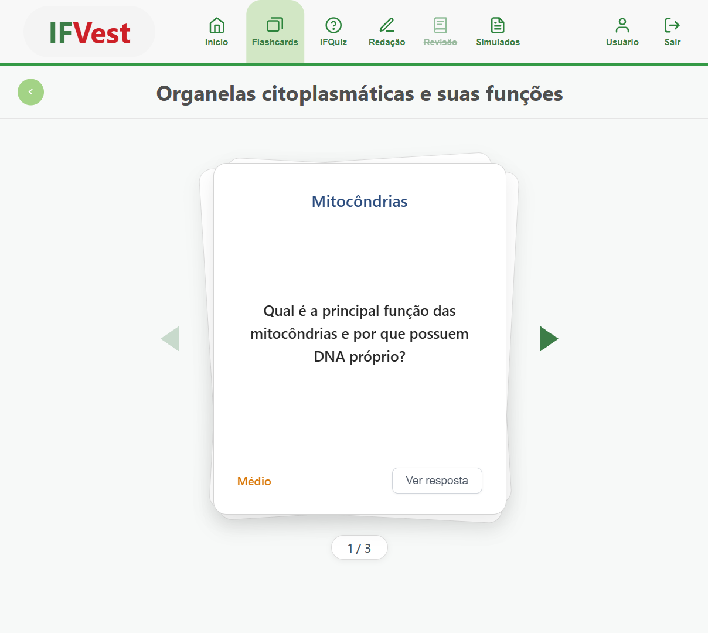
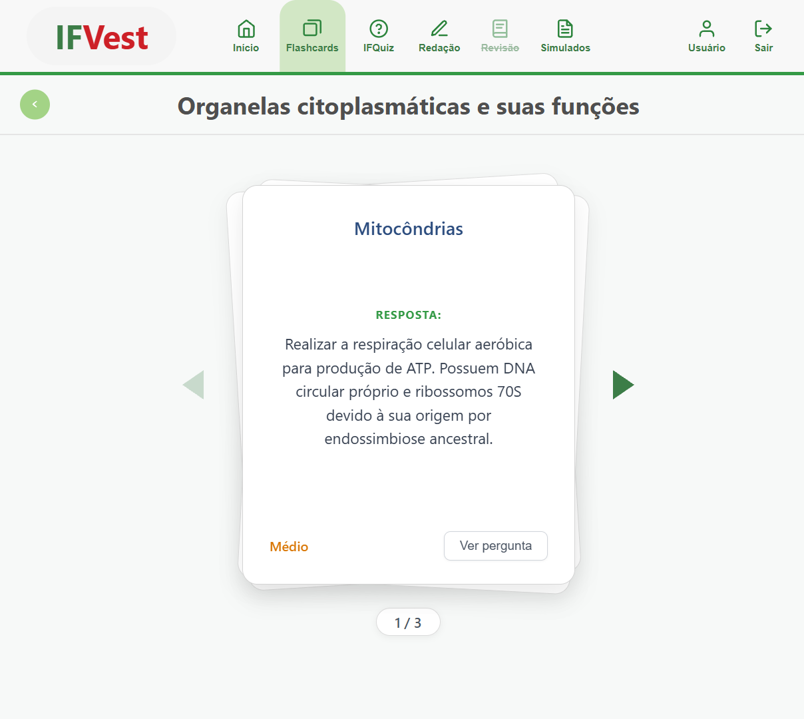

# Flashcards

O módulo de **Flashcards** (`/flashcards`) reúne cartões de estudo no formato pergunta e resposta: a frente do cartão traz a pergunta, e o verso, a resposta. Os cartões ficam organizados por disciplina, assunto e subassunto, e você os percorre um a um, no seu ritmo.

---

## Tarefa 1 — Escolher o que estudar

**Status:** ✅ Disponível  
**Acesso:** com conta

**Objetivo:** chegar aos cartões de um conteúdo específico.

**Pré-requisitos:** [estar logado](../conta/acesso.md#tarefa-1-entrar-na-plataforma).

**Como fazer:**

1. No cabeçalho ou na página **Início**, clique em **Flashcards**.
2. As disciplinas aparecem agrupadas por área do conhecimento:

    | Área | Disciplinas |
    |---|---|
    | **Linguagens e Códigos** | Língua portuguesa, Artes, Inglês, Espanhol e Educação física |
    | **Ciências Humanas** | História, Geografia, Filosofia e Sociologia |
    | **Ciências da Natureza** | Biologia, Química e Física |
    | **Exatas e Matemática** | Matemática e Raciocínio lógico |
    | **Outros e Atualidades** | Outros |

    { .captura loading=lazy }

3. Clique na disciplina. A página dela lista os assuntos; o primeiro já vem aberto.
4. Clique num assunto para abrir ou fechar a lista dos subassuntos dele.

    { .captura loading=lazy }

5. Clique no subassunto. Os cartões dele se abrem ([Tarefa 2](#tarefa-2-estudar-os-cartoes)).

Para voltar à lista de disciplinas, use a seta no topo da página.

**Observações:**

- A organização dos flashcards em assuntos e subassuntos é própria do módulo e não segue a do banco de questões.

---

## Tarefa 2 — Estudar os cartões

**Status:** ✅ Disponível  
**Acesso:** com conta

**Objetivo:** responder mentalmente a cada pergunta e conferir a resposta.

**Pré-requisitos:** ter escolhido um subassunto ([Tarefa 1](#tarefa-1-escolher-o-que-estudar)).

**Como fazer:**

1. Leia a pergunta na frente do cartão. No rodapé, uma etiqueta mostra a dificuldade: **Fácil**, **Médio** ou **Difícil**.

    { .captura loading=lazy }

2. Tente responder antes de virar o cartão.
3. Clique em **Ver resposta**. O cartão vira e mostra a **Resposta:**. Para voltar à pergunta, clique em **Ver pergunta**.

    { .captura loading=lazy }

4. Passe ao próximo cartão pela seta da direita (**Próximo flashcard**) e volte pela seta da esquerda (**Flashcard anterior**). Abaixo do cartão, o contador mostra em que posição você está, como "3 / 10".

**Observações:**

- Os cartões aparecem sempre na mesma ordem. O módulo não registra quais você já estudou nem o seu desempenho: para repetir um subassunto, abra-o de novo.
- Ao passar para outro cartão, ele começa pela pergunta.

---

## Erros e situações comuns

| Situação | O que fazer |
|---|---|
| O item **Flashcards** aparece desabilitado ou a página mostra **Em Breve** | O módulo está desligado. Ele é ligado e desligado pela administração da plataforma (ver [Módulos](../administrador/modulos.md)) |
| A seta de um lado não responde | Você está no primeiro ou no último cartão do subassunto |

---

## Fontes desta página

| Conteúdo | Fonte | Data |
|---|---|---|
| Telas, botões e fluxo | Código do frontend do `ifvest-monorepo` (commit `0335118`, de 17/11/2026): `ifvest-frontend/src/features/flashcards/` e rotas `/flashcards` | nov/2026 |
| Disponibilidade do módulo | Flag `module_flashcards`; consulta pública `GET /api/v1/features` em `ifvest.com.br` | 18/11/2026 |
| Capturas de tela | Ambiente local da equipe (`ifvest-monorepo`, commit `0335118`), com login de teste e dados de exemplo | nov/2026 |
