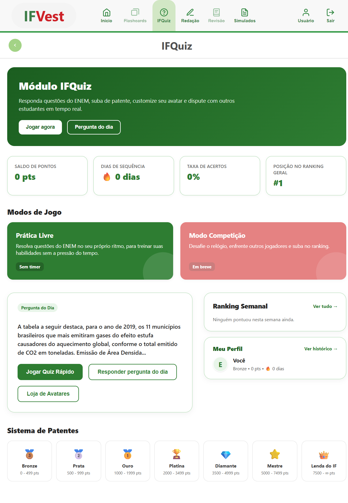
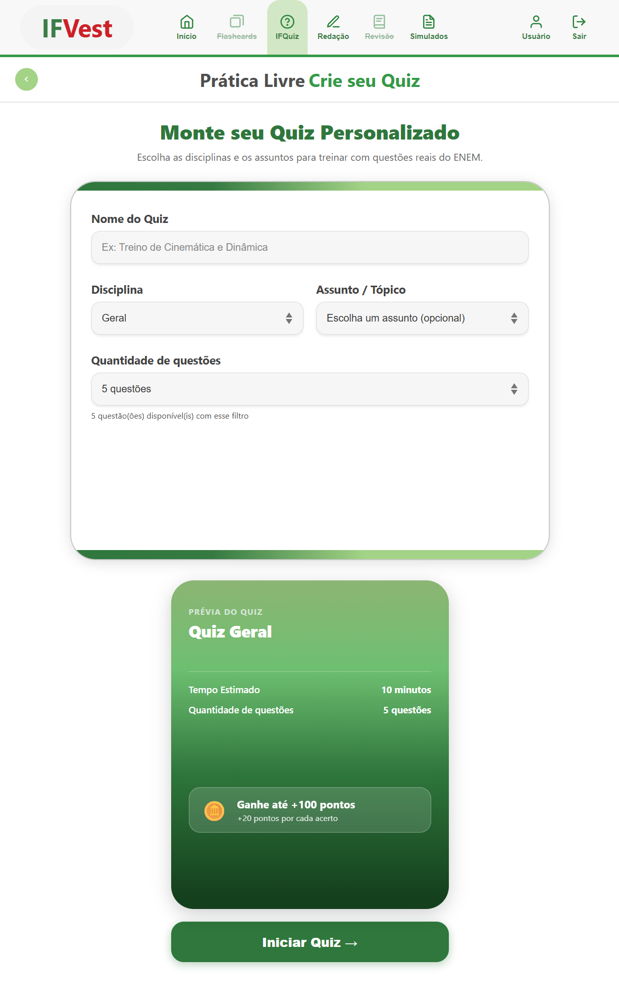
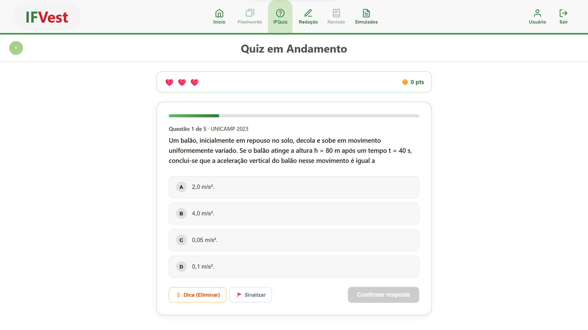
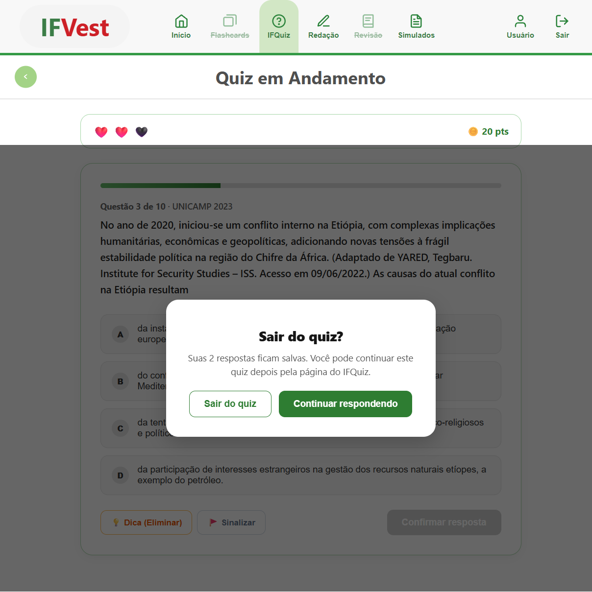
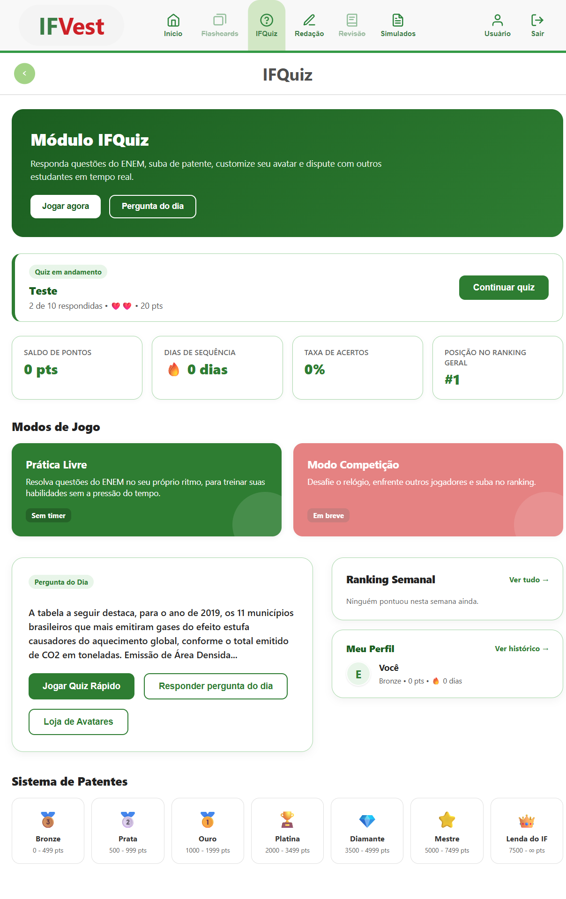
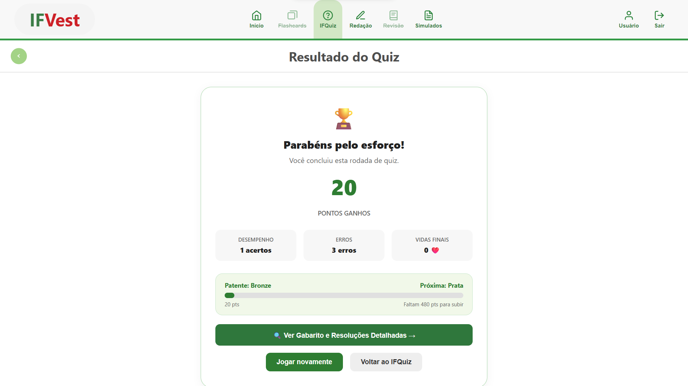
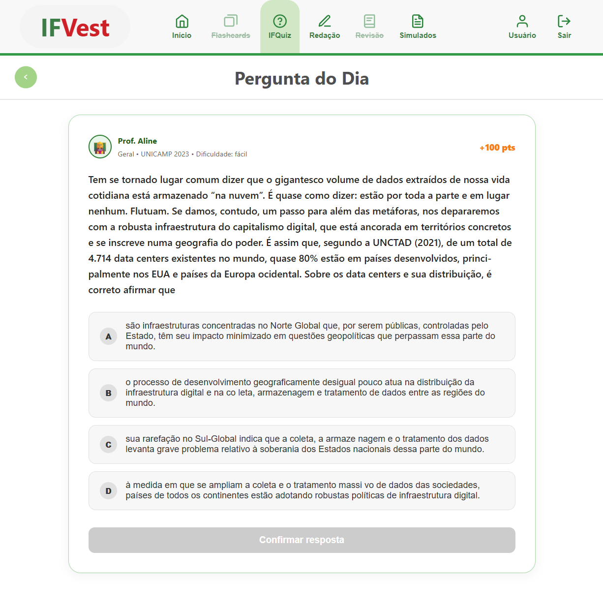
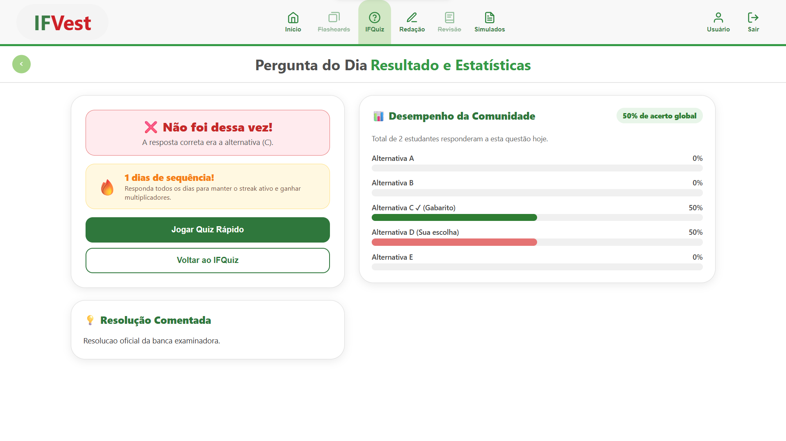
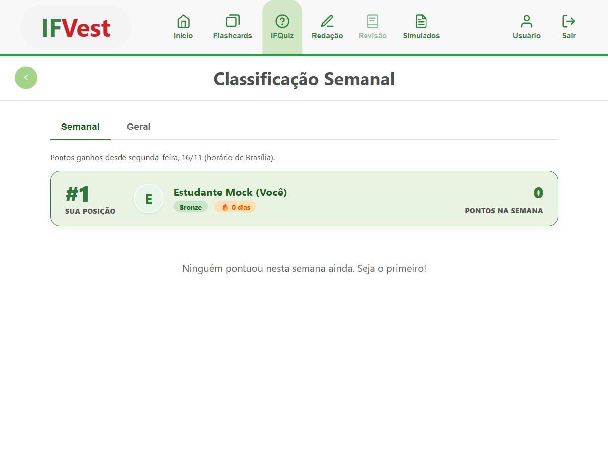
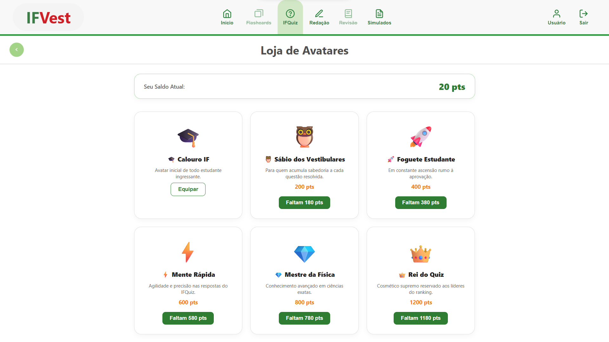

# IFQuiz

O **IFQuiz** (`/quiz`) é o módulo de prática rápida do IFVest, com elementos de jogo: quizzes montados por você com as questões do banco da plataforma, uma **Pergunta do Dia** igual para todos, **pontos**, **patentes**, **ranking** e uma **loja de avatares**. Diferente dos [Simulados](simulados.md), o foco aqui é o treino curto e o retorno imediato.

Para abrir o módulo, clique em **IFQuiz** no cabeçalho ou no cartão do módulo na página **Início**. A página do IFQuiz reúne os seus indicadores — saldo de pontos, dias de sequência, taxa de acertos e posição no ranking geral —, o quiz que você deixou em andamento, quando houver, os modos de jogo, uma prévia da Pergunta do Dia, os três primeiros do ranking da semana e a tabela de patentes.

{ .captura loading=lazy }

---

## Tarefa 1 — Montar e jogar um quiz

**Status:** ✅ Disponível  
**Acesso:** com conta

**Objetivo:** praticar questões de uma disciplina e dos assuntos que você escolher, com correção a cada resposta.

**Pré-requisitos:** ter entrado na plataforma (ver [Acesso e Conta](../conta/acesso.md#tarefa-1-entrar-na-plataforma)).

**Como fazer:**

1. Na página do IFQuiz, clique em **Jogar agora** ou no modo **Prática Livre**.
2. Na tela **Monte seu Quiz Personalizado** (`/quiz/criar`), defina:

    | Campo | Como preencher |
    |---|---|
    | **Nome** | Opcional. Sem nome, o quiz se chama "Quiz Geral" ou "Quiz de" e o nome da disciplina |
    | **Disciplina** | "Geral", que reúne todas, ou uma das disciplinas com questões no banco |
    | **Assunto / Tópico** | Opcional. Você pode escolher vários assuntos da disciplina |
    | **Quantidade de questões** | 5, 10, 15 ou 20. Quando o filtro tem menos de 5 questões, a lista oferece também esse número |

    { .captura loading=lazy }

3. Confira a **prévia do quiz**, com o tempo estimado — 2 minutos por questão — e os pontos possíveis, e clique em **Iniciar Quiz →**.
4. As questões aparecem uma de cada vez, com a posição no quiz — "Questão 3 de 10" — e, quando registradas, a banca e o ano da prova de origem, como "UNICAMP 2023". O texto de apoio vem antes do enunciado, quando a questão tem um. Escolha uma alternativa e clique em **Confirmar resposta**.

    { .captura loading=lazy }

5. A tela mostra na hora se você acertou e qual é a alternativa correta. Clique em **Próxima questão →** para seguir.
6. O quiz termina quando você responde a todas as questões ou perde as três vidas. Clique em **Ver resultado 🏆** (ver [Tarefa 3](#tarefa-3-ver-o-resultado-e-revisar-as-questoes)).

**Observações:**

- **Vidas:** você começa com 3. Cada erro custa uma, e o quiz termina no terceiro erro.
- **Dica:** o botão **💡 Dica (Eliminar)** elimina uma alternativa errada, uma vez por questão. Ele não pode ser usado quando resta só uma vida.
- Não há cronômetro, e cada acerto vale **20 pontos**. Os pontos aparecem durante a partida, mas são somados ao seu saldo só no fim do quiz.
- O topo da tela mostra as vidas, os pontos da partida e, depois de um acerto, o **🔥 Combo**, que conta os acertos seguidos. O combo não muda a pontuação.
- Abaixo da quantidade, a tela mostra quantas questões o filtro tem. As quantidades maiores que esse número ficam desabilitadas; quando o filtro tem menos de 5 questões, a lista inclui o próprio número, para você jogar com todas elas.
- Você pode sair no meio do quiz e continuar depois (ver [Tarefa 2](#tarefa-2-sair-de-um-quiz-e-continuar-depois)).
- O quiz e a Pergunta do Dia usam só questões já revisadas e aprovadas pela equipe da plataforma. As questões novas entram no quiz depois dessa revisão.
- Não há escolha de dificuldade: o filtro foi retirado porque a dificuldade registrada nas questões ainda não reflete a real.
- Se encontrar um erro numa questão, use o botão **🚩 Sinalizar** (ver [Simulados — Denunciar um erro numa questão](simulados.md#tarefa-8-denunciar-um-erro-numa-questao)).

---

## Tarefa 2 — Sair de um quiz e continuar depois

**Status:** ✅ Disponível  
**Acesso:** com conta

**Objetivo:** interromper um quiz e retomá-lo de onde parou, sem perder as respostas.

**Pré-requisitos:** ter começado um quiz ([Tarefa 1](#tarefa-1-montar-e-jogar-um-quiz)).

**Como fazer:**

1. Durante o quiz, clique na seta de voltar, no topo da tela **Quiz em Andamento**. Se você já respondeu a alguma questão, a plataforma pergunta *"Sair do quiz?"* e avisa que as respostas ficam salvas.

    { .captura loading=lazy }

2. Clique em **Sair do quiz** para voltar à página do IFQuiz, ou em **Continuar respondendo** para seguir no quiz.
3. Para retomar, abra a página do IFQuiz. O cartão **Quiz em andamento** mostra o nome do quiz, quantas questões você já respondeu, as vidas e os pontos. Clique em **Continuar quiz**.

    { .captura loading=lazy }

4. O quiz segue a partir da questão seguinte às que você já respondeu, com as vidas, os pontos e o combo de antes.

**Observações:**

- Cada resposta é gravada quando você a confirma. Por isso o quiz fica em aberto mesmo que você saia por outro caminho, como os links do cabeçalho; nesse caso, a plataforma não pede confirmação.
- O cartão da página do IFQuiz mostra o quiz em aberto mais recente. Todos os quizzes em aberto aparecem no **Histórico de quizzes** do seu [perfil](../conta/perfil.md#tarefa-3-acompanhar-a-sua-atividade) como **Em andamento**, com o botão **Continuar**.
- Os pontos do quiz entram no seu saldo só quando ele termina.

---

## Tarefa 3 — Ver o resultado e revisar as questões

**Status:** ✅ Disponível  
**Acesso:** com conta

**Objetivo:** conferir o seu desempenho no quiz e rever cada questão com o gabarito.

**Pré-requisitos:** ter concluído um quiz.

**Como fazer:**

1. Ao fim do quiz, a tela **Resultado do Quiz** mostra os pontos ganhos, os acertos, os erros, as vidas restantes e o progresso até a próxima [patente](#tarefa-6-ganhar-pontos-e-subir-de-patente).

    { .captura loading=lazy }

2. Para rever as questões, clique em **🔍 Ver Gabarito e Resoluções Detalhadas →**. A revisão lista as questões respondidas, com a disciplina, a banca e o ano, a alternativa que você escolheu e o gabarito oficial.
3. Para continuar, clique em **Jogar novamente**, que abre a montagem de um novo quiz, ou em **Voltar ao IFQuiz**.

**Observações:**

- Os quizzes também ficam no **Histórico de quizzes** do seu [perfil](../conta/perfil.md#tarefa-3-acompanhar-a-sua-atividade), com as ações **Revisar** e **Refazer**.

---

## Tarefa 4 — Responder à Pergunta do Dia

**Status:** ✅ Disponível  
**Acesso:** com conta

**Objetivo:** responder à questão do dia, a mesma para todos os estudantes, e comparar o seu resultado com o da comunidade.

**Pré-requisitos:** ter entrado na plataforma.

**Como fazer:**

1. Na página do IFQuiz, clique em **Pergunta do dia** ou em **Responder pergunta do dia** (`/quiz/pergunta-do-dia`).
2. Leia a questão. Acima dela aparecem a disciplina, a banca e o ano da prova, quando registrados, e a dificuldade; o texto de apoio vem antes do enunciado, quando houver. Escolha uma alternativa e clique em **Confirmar resposta**.

    { .captura loading=lazy }

3. O resultado mostra a alternativa correta, a sua [sequência diária](#tarefa-5-manter-a-sequencia-diaria) e o **desempenho da comunidade**: o percentual de acerto de todos que responderam e a distribuição das respostas por alternativa.

    { .captura loading=lazy }

4. Para continuar praticando, clique em **Jogar Quiz Rápido**, que começa direto um quiz de 5 questões de todas as disciplinas.

**Observações:**

- Há **uma resposta por dia**. Depois de responder, as alternativas ficam bloqueadas até o dia seguinte.
- O dia segue o horário de Brasília: a pergunta muda à meia-noite.
- O acerto vale **100 pontos**, somados ao saldo na hora.

---

## Tarefa 5 — Manter a sequência diária

**Status:** ✅ Disponível  
**Acesso:** com conta

**Objetivo:** acompanhar quantos dias seguidos você respondeu à Pergunta do Dia.

**Pré-requisitos:** ter respondido à [Pergunta do Dia](#tarefa-4-responder-a-pergunta-do-dia) ao menos uma vez.

**Como fazer:**

1. Responda à Pergunta do Dia todos os dias — acertando ou não.
2. Acompanhe a sequência nos indicadores da página do IFQuiz, no seu perfil, como **Dias Consecutivos**, e no ranking.

**Observações:**

- Só a resposta à Pergunta do Dia conta. Jogar quizzes ou apenas entrar na plataforma não mantém a sequência.
- Um dia sem resposta, no horário de Brasília, zera a sequência; a resposta seguinte a recomeça em 1.
- A sequência não rende pontos extras.

---

## Tarefa 6 — Ganhar pontos e subir de patente

**Status:** ✅ Disponível  
**Acesso:** com conta

**Objetivo:** entender como os pontos são ganhos e como eles definem a sua patente.

**Pré-requisitos:** nenhum.

**Como fazer:**

1. Ganhe pontos acertando questões: **20 por acerto** nos quizzes e **100 por acerto** na Pergunta do Dia.
2. Os pontos formam o seu **saldo**, que define a sua patente:

    | Patente | Pontos |
    |---|---|
    | Bronze | 0 a 499 |
    | Prata | 500 a 999 |
    | Ouro | 1.000 a 1.999 |
    | Platina | 2.000 a 3.499 |
    | Diamante | 3.500 a 4.999 |
    | Mestre | 5.000 a 7.499 |
    | Lenda do IF | 7.500 ou mais |

**Observações:**

- O saldo diminui quando você compra um avatar na [loja](#tarefa-8-comprar-e-equipar-avatares), e por isso a patente **pode cair depois de uma compra**. O ranking não é afetado, porque considera os pontos ganhos, e não o saldo.

---

## Tarefa 7 — Ver o ranking

**Status:** ✅ Disponível  
**Acesso:** com conta

**Objetivo:** comparar a sua pontuação com a dos outros estudantes.

**Pré-requisitos:** nenhum. Para aparecer no ranking, é preciso ter ganhado pontos no período.

**Como fazer:**

1. Na página do IFQuiz, clique em **Ver tudo →**, no quadro **Ranking Semanal** (`/quiz/ranking`).
2. Escolha o período na aba **Semanal**, contado a partir de segunda-feira à 0h, no horário de Brasília, ou **Geral**, com todo o histórico.
3. A tela mostra a sua posição, o pódio com os três primeiros e a tabela com o avatar, a patente e a sequência de cada estudante.

    { .captura loading=lazy }

**Observações:**

- A classificação usa os **pontos ganhos** no período — nos quizzes e na Pergunta do Dia —, e não o saldo: comprar na loja não faz você perder posição.
- Empates dividem a mesma posição.
- A tabela mostra os dez primeiros colocados.
- O nome exibido é o seu [apelido](../conta/perfil.md#tarefa-2-alterar-o-seu-apelido); sem ele, aparece a parte do seu e-mail antes do `@`.

---

## Tarefa 8 — Comprar e equipar avatares

**Status:** ✅ Disponível  
**Acesso:** com conta

**Objetivo:** escolher o avatar que aparece ao lado do seu nome no ranking.

**Pré-requisitos:** ter saldo de pontos suficiente para o avatar, exceto o gratuito.

**Como fazer:**

1. Na página do IFQuiz, clique em **Loja de Avatares** (`/quiz/loja`). O seu saldo aparece no topo.
2. Escolha um avatar:

    | Avatar | Preço |
    |---|---|
    | 🎓 Calouro IF | Gratuito |
    | 🦉 Sábio dos Vestibulares | 200 pontos |
    | 🚀 Foguete Estudante | 400 pontos |
    | ⚡ Mente Rápida | 600 pontos |
    | 💎 Mestre da Física | 800 pontos |
    | 👑 Rei do Quiz | 1.200 pontos |

    { .captura loading=lazy }

3. Clique em **Comprar**, que mostra o preço. Sem saldo suficiente, o botão mostra quantos pontos faltam.
4. Depois de comprado, clique em **Equipar**. O avatar equipado aparece marcado como **✓ Equipado** e passa a aparecer no ranking.

**Observações:**

- Cada avatar é comprado uma única vez. O gratuito pode ser equipado sem compra.
- A compra diminui o saldo e pode baixar a sua [patente](#tarefa-6-ganhar-pontos-e-subir-de-patente).

---

## Tarefa 9 — Jogar no Modo Competição

**Status:** 🔵 Prevista  
**Acesso:** com conta

**Objetivo:** disputar partidas em tempo real contra outro estudante.

O **Modo Competição** aparece na página do IFQuiz como **Em breve**, desabilitado. Segundo os requisitos da equipe do módulo, ele terá partidas entre dois estudantes, com limite de 3 minutos por questão, pontos para quem tiver o melhor desempenho e registro do resultado no histórico.

*Fonte: Levantamento de Funcionalidades e Regras de Negócio, entrada #004 do IFQuiz — ver [RF6 do IFQuiz](../../requisitos/funcionais.md#ifquiz).*

---

## Erros e situações comuns

| Situação | O que fazer |
|---|---|
| Uma quantidade de questões está desabilitada | Não há questões suficientes para a disciplina e os assuntos escolhidos. Escolha uma quantidade menor ou amplie o filtro |
| A tela diz *"Esse filtro não tem questões."* | Não há questões aprovadas para a disciplina e os assuntos escolhidos. Escolha outra disciplina ou outros assuntos |
| Saí do quiz no meio | As respostas ficam salvas. Na página do IFQuiz, clique em **Continuar quiz**, ou use **Continuar** no Histórico de quizzes do perfil |
| A dica não funciona | Ela pode ser usada uma vez por questão e não funciona quando resta só uma vida |
| Não consigo responder à Pergunta do Dia | Você já respondeu hoje. A próxima pergunta abre à meia-noite, no horário de Brasília |
| A minha sequência voltou a zero | Houve um dia sem resposta à Pergunta do Dia. Jogar quizzes não mantém a sequência |
| A minha patente caiu | Você comprou um avatar, e o saldo diminuiu. A posição no ranking não muda |
| Não apareço no ranking semanal | Só entra quem ganhou pontos desde segunda-feira, e a tabela mostra os dez primeiros |
| A página mostra "Em Breve" no lugar do IFQuiz | O módulo, ou a funcionalidade, foi desligado temporariamente por um administrador. Tente mais tarde |

---

## Fontes desta página

| Conteúdo | Fonte | Data |
|---|---|---|
| Telas, botões e fluxos | Código do frontend do `ifvest-monorepo` (commit `0335118`, de 17/11/2026): páginas do IFQuiz | nov/2026 |
| Saída e retomada do quiz | Código do `ifvest-monorepo` (commit `0335118`): rota `GET /api/v1/quiz/active-session` e `ifvest-backend/src/services/quiz_session_resume.py` | nov/2026 |
| Regras de pontos, patentes, sequência, ranking e loja | [Descrição das Funcionalidades — IFQuiz](../../funcionalidades.md#ifquiz), conferida no código do backend | nov/2026 |
| Filtro de dificuldade retirado | `docs/decisoes/0001-ocultar-seletor-de-dificuldade-do-quiz.md`, no `ifvest-monorepo` | set/2026 |
| Modo Competição | Levantamento de Funcionalidades e Regras de Negócio, entradas do IFQuiz | 20/10/2026 |
| Capturas de tela | Plataforma em produção (`ifvest.com.br`), com conta de teste, e ambiente local da equipe (`ifvest-monorepo`, commit `0335118`), com login de teste e dados de exemplo | nov/2026 |

!!! note "O que mudou em relação à versão anterior"
    A versão anterior desta página descrevia o IFQuiz da plataforma anterior: quizzes com questões de um serviço externo do ENEM e um placar com os cinco melhores resultados. O IFQuiz do V3 foi reconstruído pelo subprojeto do módulo, usa as questões do banco da própria plataforma e acrescentou a Pergunta do Dia, a sequência diária, as patentes, o ranking e a loja.
