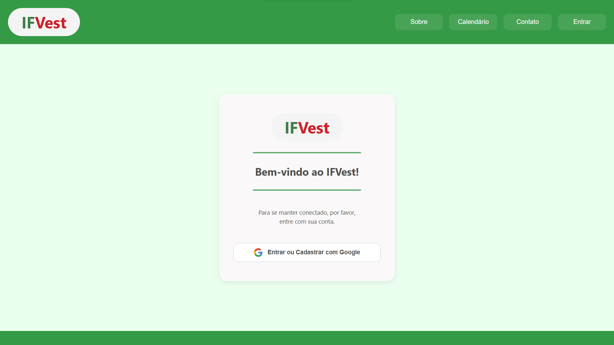
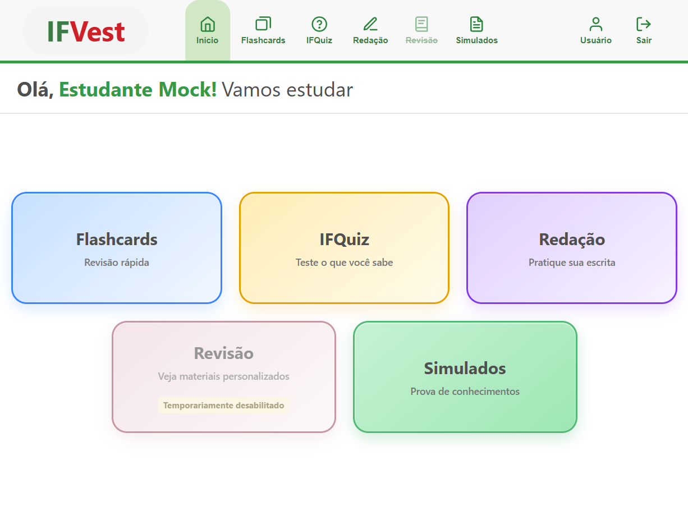

# Acesso e Conta

Esta página reúne as tarefas de acesso à plataforma: entrar — o que, no primeiro acesso, também cria a sua conta —, completar o cadastro, sair e ligar o alto contraste. Ela vale para todos; o que cada pessoa pode fazer depois de entrar depende das [permissões](../../descricao-do-sistema.md#perfis-e-permissoes) da conta.

O IFVest **não tem senha própria**: a entrada é feita com a **conta Google**.

---

## Tarefa 1 — Entrar na plataforma

**Status:** ✅ Disponível  
**Acesso:** qualquer pessoa com uma conta Google

**Objetivo:** iniciar uma sessão para usar os módulos da plataforma. No primeiro acesso, a sua conta do IFVest é criada automaticamente.

**Pré-requisitos:** ter uma conta Google. Um e-mail institucional também serve, desde que seja uma conta Google.

**Como fazer:**

1. Na página inicial do IFVest (`ifvest.com.br`), clique em **Entrar**, no cabeçalho, ou em **Quero acessar a plataforma!**.
2. Na tela de entrada (`/login`), clique em **Entrar ou Cadastrar com Google**. O mesmo botão serve para o primeiro acesso e para os seguintes.

    { .captura loading=lazy }

3. Na janela do Google, escolha a conta e confirme.
4. Você é levado à página **Início** (`/inicio`), com uma saudação pelo seu apelido e um cartão para cada módulo. No primeiro acesso, a janela **Complete seu cadastro** aparece por cima: preencha-a antes de continuar (ver [Tarefa 2](#tarefa-2-completar-o-cadastro-e-aceitar-os-termos)).

    { .captura loading=lazy }

**Observações:**

- **No primeiro acesso**, a conta é criada a partir do e-mail da conta Google, com o apelido **Estudante** e sem permissões especiais. As permissões de professor e as demais são concedidas por um administrador (ver [Guia do Professor — Permissões](../professor/index.md)). As contas `@ifsp.edu.br` criadas antes de 18/11/2026 receberam as permissões de professor automaticamente e as mantêm.
- Nos acessos seguintes, a conta é reconhecida pelo mesmo e-mail. Entrar com outra conta Google cria outra conta no IFVest, sem o seu histórico.
- A janela do Google é aberta como janela separada do navegador (*pop-up*). Se ela não aparecer, permita as janelas do IFVest nas configurações do navegador.

---

## Tarefa 2 — Completar o cadastro e aceitar os termos

**Status:** ✅ Disponível  
**Acesso:** com conta

**Objetivo:** escolher o seu apelido e as suas preferências de privacidade e aceitar os Termos de Uso e a Política de Privacidade, o que a plataforma pede antes do primeiro uso.

**Pré-requisitos:** ter entrado na plataforma (ver [Tarefa 1](#tarefa-1-entrar-na-plataforma)).

**Como fazer:**

1. Depois de entrar pela primeira vez, a janela **Bem-vindo ao IFVest! Complete seu cadastro** aparece sobre a tela.
2. Em **Apelido na plataforma (opcional)**, mantenha ou troque o apelido. O campo vem preenchido com **Estudante**, o apelido que a plataforma dá às contas novas.
3. Em **Faixa etária**, marque **Tenho 18 anos ou mais** ou **Sou menor de 18 anos e possuo ciência/autorização dos meus pais ou responsáveis**. Na segunda opção, preencha o **E-mail do responsável legal**, que é obrigatório.
4. Deixe marcada a opção **Desejo aparecer no Ranking público do IFVest** ou desmarque-a para ficar fora do [ranking](../aluno/ifquiz.md#tarefa-7-ver-o-ranking).
5. Marque **Li e concordo com os Termos de Uso e a Política de Privacidade**. Os dois nomes são links que abrem os textos em outra aba.
6. Clique em **Concluir e Começar**.

**Observações:**

- A janela não fecha sem o aceite dos termos: enquanto ele não é feito, ela continua sobre as telas. Ela aparece também, uma vez, para quem já tinha conta antes de o aceite existir.
- O apelido e a presença no ranking podem ser mudados depois, no perfil (ver [Alterar o seu apelido](perfil.md#tarefa-2-alterar-o-seu-apelido) e [Sair do ranking](perfil.md#tarefa-4-sair-do-ranking-ou-voltar-a-ele)).
- A **Política de Privacidade** (`/privacidade`) e os **Termos de Uso** (`/termos`) também podem ser lidos antes de entrar, pelos links **Política de Privacidade do Portal IFVest** e **Termos de Uso**, no rodapé da página inicial.

---

## Tarefa 3 — Sair da plataforma

**Status:** ✅ Disponível  
**Acesso:** com conta

**Objetivo:** encerrar a sua sessão, especialmente em computadores compartilhados.

**Pré-requisitos:** ter entrado na plataforma.

**Como fazer:**

1. Clique em **Sair**, no canto direito do cabeçalho, ao lado de **Usuário**.
2. A sessão é encerrada, e você volta à página inicial pública.

**Observações:**

- Fechar a aba **não** encerra a sessão: ao abrir o IFVest de novo no mesmo navegador, você continua conectado. Em computador compartilhado, como no laboratório, use **Sair** ao terminar.
- Sair do IFVest não sai da sua conta Google no navegador. Em computador compartilhado, saia também da conta Google, para que a próxima pessoa não a encontre aberta.
- Ao sair, a plataforma apaga deste navegador os rascunhos de redação (ver [Redação](../aluno/redacao.md#tarefa-2-escrever-e-enviar-uma-redacao)).

---

## Tarefa 4 — Ligar o alto contraste

**Status:** ✅ Disponível  
**Acesso:** qualquer pessoa, com ou sem conta

**Objetivo:** usar a plataforma com cores de alto contraste, que facilitam a leitura.

**Pré-requisitos:** nenhum.

**Como fazer:**

1. No cabeçalho, clique em **◐ Alto Contraste**.
2. Para voltar às cores normais, clique de novo no mesmo botão.

**Observações:**

- A escolha fica guardada **neste navegador** e vale nas próximas visitas. Em outro navegador ou computador, ligue de novo.
- Quem navega pelo teclado encontra, ao apertar `Tab` pela primeira vez, o link **Pular para o conteúdo principal**, que leva direto ao conteúdo da página, sem passar pelo cabeçalho.

---

## Erros e situações comuns

| Situação | O que fazer |
|---|---|
| As telas aparecem com zeros ou listas vazias | A sua sessão pode ter terminado. As telas internas abrem mesmo sem login, mas os dados só carregam para quem entrou: entre de novo ([Tarefa 1](#tarefa-1-entrar-na-plataforma)) |
| A janela do Google não abriu | O navegador pode estar bloqueando janelas *pop-up*. Permita as janelas do IFVest e clique de novo no botão |
| Esqueci a minha senha | O IFVest não tem senha própria. Recupere a senha da sua conta Google pelo próprio Google |
| Entrei, mas não vejo as abas **Professor**, **Auditoria** ou **Admin** | Elas aparecem só para quem tem as permissões correspondentes, logo depois que a plataforma as carrega. Se você deveria tê-las, peça a um administrador |
| A janela **Complete seu cadastro** mostra *"Você deve concordar com os Termos de Uso e a Política de Privacidade para continuar."* | Marque o aceite dos termos e clique de novo em **Concluir e Começar** |
| A janela mostra *"O e-mail do responsável é obrigatório para estudantes menores de 18 anos."* | Preencha o **E-mail do responsável legal**, ou corrija a faixa etária se ela estiver marcada por engano |
| Ação recusada por falta de permissão | A mensagem *"Você não tem a permissão '…' para concluir esta ação"* indica a permissão que falta à sua conta. Nas ações que aceitam mais de uma permissão, ela começa por *"Você precisa de uma das seguintes permissões"* e lista as possíveis. Peça uma delas a um administrador |

---

## O que mudou em relação ao planejado

O design do subprojeto de frontend previa, além da entrada pelo Google, o **cadastro por formulário**, com nome de usuário e senha, e a **recuperação de senha** em três etapas — informar o e-mail, validar um código e definir a nova senha. O IFVest V3 adotou **só a entrada pela conta Google**, e por isso essas tarefas não existem: não há senha do IFVest a cadastrar nem a recuperar.

Os requisitos dessas funcionalidades continuam registrados como não atendidos em [Requisitos Funcionais — Conta e acesso](../../requisitos/funcionais.md#conta-e-acesso).

---

## Fontes desta página

| Conteúdo | Fonte | Data |
|---|---|---|
| Telas, botões e fluxos | Código do frontend do `ifvest-monorepo` (commit `e4d7eef`, de 18/11/2026): página inicial, tela de entrada, cabeçalho, rodapé e sessão | nov/2026 |
| Criação da conta e permissões iniciais | [Descrição das Funcionalidades — Conta e acesso](../../funcionalidades.md#conta-e-acesso), conferida no código do backend (commit `e4d7eef`): `src/api/v1/auth.py` e `src/core/permissions.py` | nov/2026 |
| Cadastro no primeiro acesso e alto contraste | Código do frontend (commit `e4d7eef`): `LgpdOnboardingModal.tsx`, `AppLayout.tsx` e `useHighContrast.ts`; backend: `src/services/user_lgpd_service.py` | nov/2026 |
| Design anterior: cadastro por formulário e recuperação de senha | Relatório 1 — Maria Luiza, subprojeto *Refatoração para React e Redesign do IFVest*, itens 2 e 3 | abr/2026 |
| Capturas de tela | Plataforma em produção (`ifvest.com.br`), com conta de teste, e ambiente local da equipe (`ifvest-monorepo`, commit `0335118`), com login de teste e dados de exemplo | nov/2026 |
