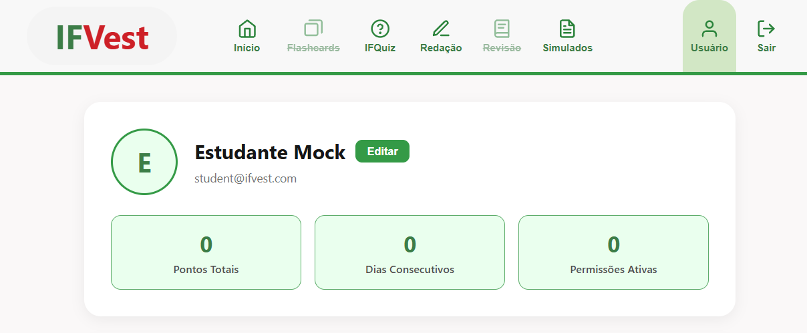
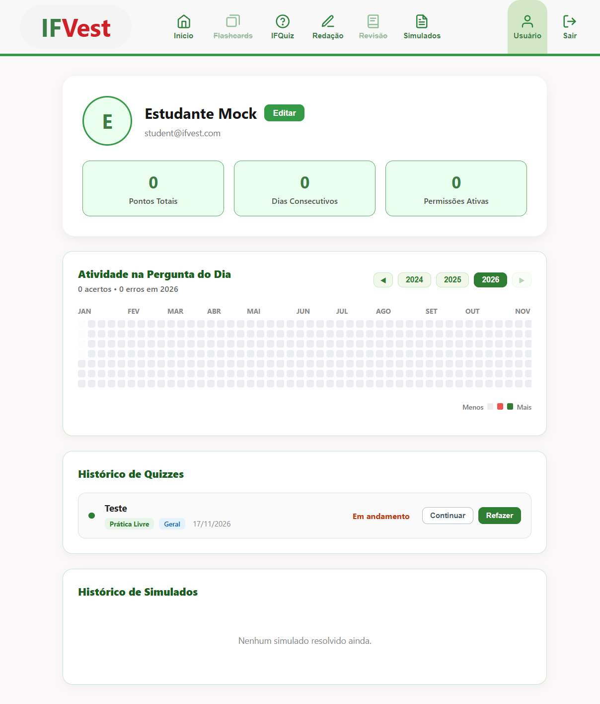

# Perfil e Seus Dados

Esta página reúne as tarefas da área de **perfil** (`/perfil`): consultar os seus indicadores, alterar o apelido, acompanhar a sua atividade no IFQuiz e nos Simulados e cuidar da sua privacidade — sair do ranking, exportar os seus dados e excluir a conta. Ela vale para todos que têm conta.

Para abrir o perfil, clique em **Usuário**, no canto direito do cabeçalho.

---

## Tarefa 1 — Consultar o seu perfil

**Status:** ✅ Disponível  
**Acesso:** com conta

**Objetivo:** ver os dados da sua conta e o resumo do seu uso da plataforma.

**Pré-requisitos:** ter entrado na plataforma (ver [Acesso e Conta](acesso.md#tarefa-1-entrar-na-plataforma)).

**Como fazer:**

1. Clique em **Usuário**, no cabeçalho.
2. O perfil mostra o seu apelido, o e-mail da conta e três indicadores:

    | Indicador | O que mostra |
    |---|---|
    | **Pontos Totais** | O seu saldo de pontos do IFQuiz, que diminui quando você compra na [loja de avatares](../aluno/ifquiz.md#tarefa-8-comprar-e-equipar-avatares) |
    | **Dias Consecutivos** | A sua [sequência diária](../aluno/ifquiz.md#tarefa-5-manter-a-sequencia-diaria) na Pergunta do Dia |
    | **Permissões Ativas** | Quantas permissões a sua conta tem, como as de professor |

    { .captura loading=lazy }

---

## Tarefa 2 — Alterar o seu apelido

**Status:** ✅ Disponível  
**Acesso:** com conta

**Objetivo:** definir o nome que identifica você na plataforma.

**Pré-requisitos:** os mesmos da [Tarefa 1](#tarefa-1-consultar-o-seu-perfil).

**Como fazer:**

1. No perfil, clique em **Editar**, ao lado do apelido.
2. Digite o novo apelido.
3. Clique em **Salvar**.

**Observações:**

- O apelido aparece na saudação da página **Início** e no [ranking do IFQuiz](../aluno/ifquiz.md#tarefa-7-ver-o-ranking).
- As contas novas recebem o apelido **Estudante**, que pode ser trocado já no [cadastro do primeiro acesso](acesso.md#tarefa-2-completar-o-cadastro-e-aceitar-os-termos). Nas contas antigas que ficaram sem apelido, a saudação usa o nome da conta Google, o perfil mostra "Sem apelido", e o ranking mostra a parte do e-mail antes do `@`.

---

## Tarefa 3 — Acompanhar a sua atividade

**Status:** ✅ Disponível  
**Acesso:** com conta

**Objetivo:** rever o que você fez no IFQuiz e nos Simulados e retomar o estudo a partir daí.

**Pré-requisitos:** os mesmos da [Tarefa 1](#tarefa-1-consultar-o-seu-perfil).

**Como fazer:**

Abaixo dos indicadores, o perfil reúne três quadros:

- **Atividade na Pergunta do Dia** — um mapa de calor do ano, com um quadrado por dia: verde para acerto, vermelho para erro e cinza para os dias sem resposta. Mostra os totais de acertos e erros e permite trocar o ano.
- **Histórico de quizzes** — os dez quizzes iniciados mais recentemente, com acertos e pontos. **Revisar** abre o gabarito do quiz, e **Refazer** abre a montagem com os mesmos filtros. Um quiz que você deixou no meio aparece como **Em andamento**, e o botão **Continuar** o retoma de onde parou (ver [IFQuiz — Sair de um quiz e continuar depois](../aluno/ifquiz.md#tarefa-2-sair-de-um-quiz-e-continuar-depois)).
- **Histórico de Simulados** — as suas tentativas de simulado, da mais recente para a mais antiga, cinco por página, com o título, as disciplinas, a data, os acertos e a nota. **Revisar** abre a revisão das questões daquela tentativa (ver [Simulados — Revisar as questões de uma tentativa](../aluno/simulados.md#tarefa-5-revisar-as-questoes-de-uma-tentativa)), e **Refazer** abre o simulado de novo.

{ .captura loading=lazy }

**Observações:**

- O Histórico de Simulados não aparece quando o módulo de Simulados está desligado.

---

## Tarefa 4 — Sair do ranking ou voltar a ele

**Status:** ✅ Disponível  
**Acesso:** com conta

**Objetivo:** decidir se o seu apelido e os seus pontos aparecem no [ranking público do IFQuiz](../aluno/ifquiz.md#tarefa-7-ver-o-ranking).

**Pré-requisitos:** os mesmos da [Tarefa 1](#tarefa-1-consultar-o-seu-perfil).

**Como fazer:**

1. No fim do perfil, na seção **Privacidade e Dados Pessoais (LGPD)**, desmarque **Exibir meu perfil no Ranking público** para sair do ranking, ou marque-a para voltar.
2. A escolha é salva na hora, com a mensagem **Preferência de visibilidade salva com sucesso.**

**Observações:**

- Fora do ranking, os seus pontos continuam contando no seu perfil, e você continua vendo a sua própria posição na tela do ranking. Só os outros deixam de ver o seu apelido na classificação.
- A mesma escolha aparece no [cadastro do primeiro acesso](acesso.md#tarefa-2-completar-o-cadastro-e-aceitar-os-termos).

---

## Tarefa 5 — Exportar os seus dados

**Status:** ✅ Disponível  
**Acesso:** com conta

**Objetivo:** baixar uma cópia dos seus dados pessoais guardados pela plataforma, um direito previsto na LGPD.

**Pré-requisitos:** os mesmos da [Tarefa 1](#tarefa-1-consultar-o-seu-perfil).

**Como fazer:**

1. Na seção **Privacidade e Dados Pessoais (LGPD)**, clique em **Exportar meus dados (JSON)**.
2. O navegador baixa o arquivo `ifvest-meus-dados.json`, e a seção mostra **Dados exportados com sucesso em arquivo JSON.**

**Observações:**

- O arquivo traz os dados da conta — e-mail, apelido, pontos, sequência diária, permissões, a escolha sobre o ranking e o registro do aceite dos termos —, as suas redações, com a nota e o comentário da correção, as tentativas de simulado, os quizzes e as compras na loja de avatares.
- JSON é um formato de texto organizado, que pode ser aberto em qualquer editor de texto ou importado em outros programas.

---

## Tarefa 6 — Excluir a sua conta

**Status:** ✅ Disponível  
**Acesso:** com conta

**Objetivo:** apagar de vez a sua conta e os seus dados pessoais da plataforma.

**Pré-requisitos:** os mesmos da [Tarefa 1](#tarefa-1-consultar-o-seu-perfil). Se quiser guardar uma cópia, [exporte os seus dados](#tarefa-5-exportar-os-seus-dados) antes.

**Como fazer:**

1. Na seção **Privacidade e Dados Pessoais (LGPD)**, clique em **Excluir minha conta permanentemente**.
2. Na janela **Excluir conta permanentemente?**, clique em **Sim, excluir definitivamente** — ou em **Cancelar**, para desistir.
3. A plataforma encerra a sua sessão e volta à página inicial.

!!! warning "A exclusão não pode ser desfeita"
    São apagados a conta, as permissões, as redações enviadas, com as correções, as tentativas de simulado, os quizzes, as respostas da Pergunta do Dia, as compras na loja e as denúncias de questões. A conta não pode ser recuperada.

**Observações:**

- O que você criou para outras pessoas continua na plataforma, mas sem o seu nome: propostas de redação, correções feitas, simulados institucionais e importações de questões.
- A sua conta Google não é afetada. Se você entrar de novo com ela, o IFVest cria uma conta nova, vazia.

---

## Previstas, ainda não disponíveis

**Status:** 🔵 Prevista

O design do subprojeto de frontend e a especificação anterior previam, na área de perfil, duas tarefas que o IFVest V3 ainda não oferece:

- **Trocar a foto de perfil** — não há tela para enviar uma foto de perfil. A imagem que aparece no ranking é o avatar escolhido na loja do IFQuiz.
- **Trocar a senha** — não se aplica: o IFVest não tem senha própria, e a senha é a da sua conta Google.

*Fonte: Relatório 1 — Maria Luiza, subprojeto Refatoração para React e Redesign do IFVest, item 4; requisito [RFG03](../../requisitos/funcionais.md#rfg03).*

---

## Seus dados na plataforma

Da sua conta Google, o IFVest guarda **apenas o e-mail**, que identifica a sua conta. Além dele, a plataforma registra:

- o apelido e o avatar, as suas permissões e a escolha de aparecer ou não no ranking;
- a data e a versão do aceite dos termos, a faixa etária informada no cadastro e, para menores de 18 anos, o e-mail do responsável;
- os dados do seu uso: pontos, sequência diária, respostas aos quizzes, tentativas de simulado, redações enviadas e denúncias de erro em questões;
- os registros de acesso: a cada entrada, o endereço IP, o navegador usado e a data e a hora. Eles são guardados por 6 meses, como exige o Marco Civil da Internet, e apagados depois.

Os detalhes estão na **Política de Privacidade** da plataforma (`/privacidade`). Para consultar ou apagar os seus dados, use as tarefas [Exportar os seus dados](#tarefa-5-exportar-os-seus-dados) e [Excluir a sua conta](#tarefa-6-excluir-a-sua-conta).

---

## Erros e situações comuns

| Situação | O que fazer |
|---|---|
| Os indicadores aparecem zerados | A sua sessão pode ter terminado: entre de novo (ver [Acesso e Conta](acesso.md#erros-e-situacoes-comuns)) |
| A minha sequência voltou a zero | A sequência conta os dias seguidos com resposta à Pergunta do Dia. Um dia sem resposta a zera (ver [IFQuiz](../aluno/ifquiz.md#tarefa-5-manter-a-sequencia-diaria)) |
| Os meus pontos diminuíram | O saldo diminui quando você compra um avatar na loja. O ranking não é afetado pelas compras |
| Excluí a conta e quero voltar | A conta excluída não pode ser recuperada. Entre de novo com a conta Google para criar uma conta nova, vazia |
| Um simulado do histórico não abre com **Refazer** | Os simulados de treino criados antes de 10/10/2026 passaram a ser visíveis só para quem os criou. Se você resolveu um simulado de outra pessoa antes dessa data, a tentativa continua no histórico, e **Revisar** funciona, mas o simulado não abre mais |

---

## Fontes desta página

| Conteúdo | Fonte | Data |
|---|---|---|
| Telas, indicadores e históricos | Código do frontend do `ifvest-monorepo` (commit `e4d7eef`, de 18/11/2026): página de perfil e quadros de histórico | nov/2026 |
| Privacidade: ranking, exportação e exclusão | Código do frontend (commit `e4d7eef`): `LgpdPrivacySection.tsx`; backend: `src/api/v1/users.py` e `src/services/user_lgpd_service.py` | nov/2026 |
| Dados guardados pela plataforma | [Modelo de Dados](../../modelo-de-dados.md) e Política de Privacidade da plataforma (`/privacidade`) | nov/2026 |
| Tarefas previstas no design | Relatório 1 — Maria Luiza, subprojeto *Refatoração para React e Redesign do IFVest*, item 4 | abr/2026 |
| Capturas de tela | Ambiente local da equipe (`ifvest-monorepo`, commit `0335118`), com login de teste e dados de exemplo | nov/2026 |
