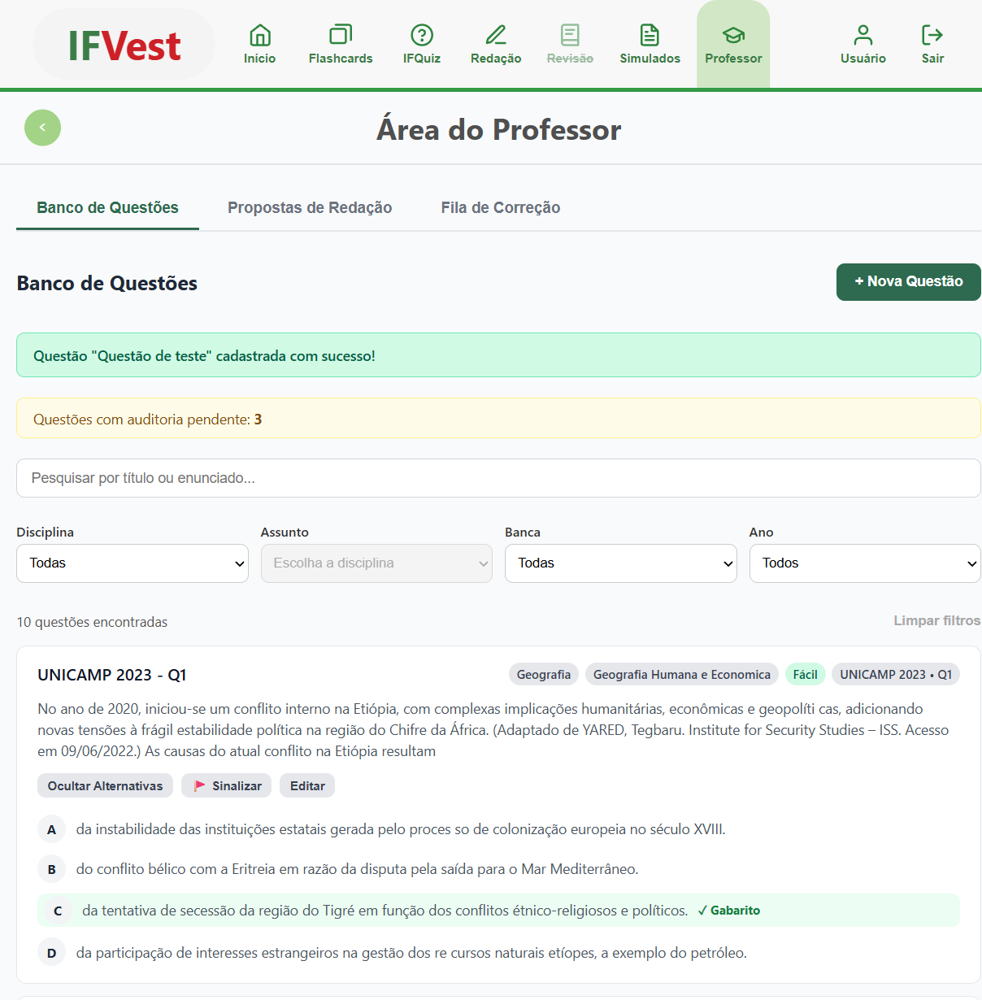
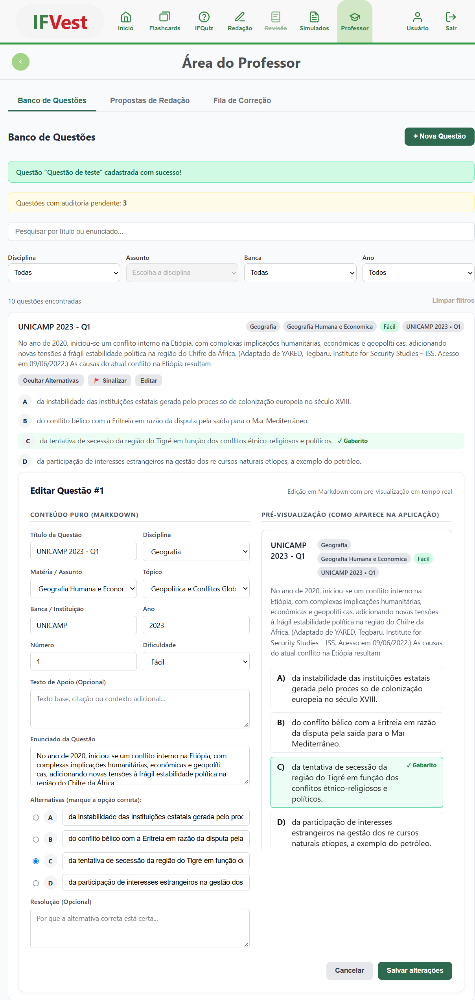

# Banco de Questões

O **banco de questões** reúne as questões de múltipla escolha usadas nos quizzes do IFQuiz e nos simulados. Cada questão se vincula a um **tópico**, dentro de um assunto e de uma disciplina (ver [Como os conteúdos são organizados](../glossario.md#como-os-conteudos-sao-organizados)), e pode aparecer em quantos quizzes e simulados houver.

O acervo combina as **provas de vestibulares**, que entram em lote pela importação, e as **questões autorais**, cadastradas uma a uma pelos professores.

Toda questão nova, autoral ou importada, entra **pendente de auditoria**. Ela só aparece na lista do banco e só passa a ser usada nos quizzes e nos simulados depois que alguém com a permissão de auditoria a aprova.

!!! info "Moderação, auditoria e importação ficam no Guia do Administrador"
    A moderação das denúncias de erro e a importação de provas em lote ficam no Painel Administrativo e exigem a permissão de administrador. A auditoria das questões tem página própria, aberta pela aba **Auditoria** do cabeçalho, e exige a permissão `audit_question`. As três estão no [Guia do Administrador](../administrador/index.md).

---

## Tarefa 1 — Consultar o banco de questões

**Status:** ✅ Disponível  
**Acesso:** qualquer permissão de conteúdo ou de redação

**Objetivo:** encontrar questões do banco e conferir o seu conteúdo.

**Pré-requisitos:** ter entrado na plataforma com uma conta que tenha permissão de professor (ver [Permissões](index.md#para-quem-e-este-guia)).

**Como fazer:**

1. No cabeçalho, clique em **Professor**. A Área do Professor abre na aba **Banco de Questões**.
2. Busque no campo **Pesquisar por título ou enunciado...** e use os filtros de **Disciplina**, **Assunto**, **Banca** e **Ano**. O assunto só pode ser escolhido depois da disciplina.
3. Confira o total abaixo dos filtros, como "1.164 questões encontradas". **Limpar filtros** desfaz a busca e os filtros. A lista vem em páginas de 20 questões.
4. Cada questão mostra o título, a disciplina, o assunto, a dificuldade, a banca, o ano e o número, além do enunciado e do texto base, quando houver. Para ver as alternativas, clique em **Ver Alternativas** — o número entre parênteses indica quantas são.

    { .captura loading=lazy }

**Observações:**

- A lista mostra as questões **de todo o banco**, e não só as cadastradas por você.
- A lista mostra só as questões já **aprovadas na auditoria**. As pendentes, incluindo as que você acabou de cadastrar, ficam na página [Auditoria de Questões](../administrador/auditoria-de-questoes.md), para quem tem a permissão `audit_question`. Com permissão de cadastrar, editar ou auditar questões, você vê acima da busca o aviso **Questões com auditoria pendente**, com o número de questões que aguardam aprovação.
- As opções de **Disciplina** e **Assunto** trazem toda a organização de conteúdos cadastrada, inclusive disciplinas e assuntos que ainda não têm questão aprovada: escolhidos, eles não trazem resultado. As de **Banca** e **Ano** vêm só das questões aprovadas.
- Com a permissão `edit_question`, as alternativas vêm com o gabarito destacado, marcado com **✓ Gabarito**, e cada questão tem o botão **Editar** (ver [Tarefa 3](#tarefa-3-editar-uma-questao)). Se a questão estiver sem alternativa correta, ou com mais de uma, aparece o aviso *"Gabarito com problema: …"*.
- Sem a permissão `edit_question`, a consulta não indica a alternativa correta.
- Para avisar sobre um erro numa questão, use o botão **🚩 Sinalizar** (ver [Tarefa 4](#tarefa-4-sinalizar-um-erro-numa-questao)).

---

## Tarefa 2 — Cadastrar uma questão

**Status:** ✅ Disponível  
**Acesso:** `create_question`

**Objetivo:** acrescentar ao banco uma questão autoral ou de uma prova que não veio pela importação.

**Pré-requisitos:** ter a permissão `create_question`.

**Como fazer:**

1. Na aba **Banco de Questões** da Área do Professor, clique em **+ Nova Questão**. O formulário **Nova Questão de Múltipla Escolha** se abre no lugar da lista.
2. Preencha os campos, na ordem em que aparecem:

    | Campo | Como preencher |
    |---|---|
    | **Título da Questão** | Obrigatório. Identifica a questão nas listas — por exemplo, "Questão 1 - Processo Seletivo 2024" |
    | **Disciplina**, **Matéria / Assunto** e **Tópico** | Obrigatórios. Digitados por você (ver aviso abaixo) |
    | **Banca / Instituição** | Obrigatório. Campo livre, que vem preenchido com IFSP |
    | **Ano** e **Número** | Obrigatórios. Vêm preenchidos com o ano atual e o número 1 |
    | **Dificuldade** | Fácil, Média ou Difícil; vem em Fácil |
    | **Texto de Apoio (Opcional)** | Texto base, citação ou contexto, exibido antes do enunciado |
    | **Enunciado da Questão** | Obrigatório |

3. Em **Alternativas (marque a opção correta)**, escreva o texto das alternativas de A a E e marque a correta.
4. Se quiser, explique em **Resolução (Opcional)** por que a alternativa correta está certa. O estudante vê a resolução em **Por que essa alternativa?**, depois de responder à questão num simulado.

    { .captura loading=lazy }

5. Clique em **Cadastrar Questão**. A mensagem *"Questão "…" cadastrada com sucesso!"* confirma o cadastro. A questão entra pendente de auditoria: ela ainda não aparece na lista, e o número do aviso **Questões com auditoria pendente** aumenta.

Para desistir, clique em **Cancelar** ou em **Fechar Formulário**.

!!! warning "A disciplina, o assunto e o tópico são digitados"
    No cadastro, não há uma lista para escolher: se o nome digitado ainda não existir, a plataforma cria um **novo ramo** na organização dos conteúdos. Um erro de digitação — "Matematica" em vez de "Matemática", por exemplo — cria uma disciplina duplicada. Antes de cadastrar, confira na [consulta](#tarefa-1-consultar-o-banco-de-questoes) como os nomes já aparecem nos filtros e nas questões existentes.

**Observações:**

- A questão cadastrada só aparece no quiz e nos simulados depois de aprovada na auditoria, por alguém com a permissão `audit_question` (ver [Guia do Administrador — Auditoria de Questões](../administrador/auditoria-de-questoes.md)).
- A alternativa **A** vem marcada como correta: confira a marcação antes de cadastrar.
- O formulário não aceita imagens. Questões com figuras entram pela importação, feita pelos administradores.
- O enunciado, o texto de apoio, as alternativas e a resolução aceitam formatação **Markdown**, como listas, tabelas e negrito. Fórmulas em **LaTeX não são formatadas**: aparecem como texto.
- Não é possível excluir uma questão depois de cadastrada. Os erros são corrigidos pela [edição](#tarefa-3-editar-uma-questao).

---

## Tarefa 3 — Editar uma questão

**Status:** ✅ Disponível  
**Acesso:** `edit_question`

**Objetivo:** corrigir uma questão do banco — o enunciado, as alternativas, o gabarito, a resolução ou a classificação.

**Pré-requisitos:** ter a permissão `edit_question`.

**Como fazer:**

1. Na aba **Banco de Questões** da Área do Professor, encontre a questão (ver [Tarefa 1](#tarefa-1-consultar-o-banco-de-questoes)).
2. Clique em **Editar**. O formulário **Editar Questão #…** se abre logo abaixo da questão, com os mesmos campos do cadastro, já preenchidos. À direita dos campos, a **Pré-visualização (como aparece na aplicação)** mostra a questão como os estudantes vão vê-la e se atualiza enquanto você digita.

    { .captura loading=lazy }

3. Altere o que for preciso: os dados da questão, o texto das alternativas, a alternativa correta, a resolução e a classificação. Na edição, a dificuldade aceita também **Não definida**.
4. Clique em **Salvar alterações**. O formulário se fecha, e a questão aparece atualizada na lista.

Para desistir, clique em **Cancelar**.

**Observações:**

- A edição exige ao menos duas alternativas, com letras diferentes, e **exatamente uma correta**.
- Pela tela, não é possível incluir ou remover alternativas nem trocar as imagens, que são mantidas como estão.
- Na edição, ao contrário do cadastro, a **Disciplina**, a **Matéria / Assunto** e o **Tópico** são escolhidos em listas, com os nomes já cadastrados. Ao trocar a disciplina, o assunto e o tópico passam para os primeiros da nova disciplina, em ordem alfabética; ao trocar o assunto, o tópico passa para o primeiro do novo assunto. Confira os três antes de salvar.
- A edição vale para todos os quizzes e simulados que usam a questão: o vínculo é com a própria questão, e não com uma cópia. As tentativas já enviadas mantêm a nota que tiveram.
- Uma questão editada fica protegida: uma importação posterior não desfaz a correção, a menos que o administrador peça para substituí-la.
- A edição não muda a situação da questão na auditoria: uma pendente continua pendente, e uma aprovada continua aprovada.
- Editar a questão não encerra as denúncias de erro feitas sobre ela. Elas são tratadas na moderação, pelos administradores (ver [Guia do Administrador — Moderação de Questões](../administrador/moderacao-de-questoes.md)).

---

## Tarefa 4 — Sinalizar um erro numa questão

**Status:** ✅ Disponível  
**Acesso:** qualquer permissão de conteúdo ou de redação

**Objetivo:** avisar a moderação sobre um erro encontrado ao consultar o banco.

**Pré-requisitos:** ter encontrado a questão no banco (ver [Tarefa 1](#tarefa-1-consultar-o-banco-de-questoes)).

**Como fazer:**

1. Na questão com problema, clique em **🚩 Sinalizar**.
2. Escolha o **Motivo do problema** e, se quiser, descreva-o em **Detalhes adicionais (opcional)**.
3. Clique em **Enviar Denúncia**.

Os passos são os mesmos da denúncia feita pelos estudantes, descrita em [Denunciar um erro numa questão](../aluno/simulados.md#tarefa-8-denunciar-um-erro-numa-questao).

**Observações:**

- Quem tem a permissão `edit_question` pode corrigir a questão direto, pela [Tarefa 3](#tarefa-3-editar-uma-questao).

---

## Erros e situações comuns

| Situação | O que fazer |
|---|---|
| A Área do Professor mostra **Acesso Restrito** | A sua conta não tem nenhuma permissão de conteúdo ou de redação. Peça-a a um administrador |
| *"Erro ao cadastrar a questão. Verifique os dados e tente novamente."* | Confira os campos e tente de novo. A mesma mensagem aparece quando a conta não tem a permissão `create_question` ou quando um administrador desligou o cadastro de questões em **Módulos (Feature Flags)** |
| O botão **Editar** não aparece nas questões | A sua conta não tem a permissão `edit_question`. Peça-a a um administrador ou [sinalize o erro](#tarefa-4-sinalizar-um-erro-numa-questao) |
| *"Gabarito com problema: …"* | A questão está sem alternativa correta ou com mais de uma. Com a permissão `edit_question`, edite-a, marque a alternativa correta e salve |
| *"Não foi possível salvar a questão. Tente novamente."* | Confira a conexão e tente de novo. Se a mensagem falar das alternativas, confira se há exatamente uma correta |
| A questão que cadastrei não aparece na lista, no quiz nem nos simulados | Ela ainda está pendente de auditoria. Peça a aprovação a quem tem a permissão `audit_question` |
| Cadastrei uma questão e a disciplina apareceu duplicada | O nome foi digitado de forma diferente da existente. Na [edição](#tarefa-3-editar-uma-questao), escolha na lista a disciplina com o nome correto |
| A fórmula do enunciado aparece como texto | A plataforma não formata LaTeX. Escreva a fórmula em texto simples ou use uma imagem, pela importação |

---

## Fontes desta página

| Conteúdo | Fonte | Data |
|---|---|---|
| Telas, botões, mensagens e fluxos | Código do frontend do `ifvest-monorepo` (commit `b0a5e5f`, de 17/11/2026): Área do Professor | nov/2026 |
| Regras de cadastro, edição e denúncia | [Descrição das Funcionalidades — Banco de questões](../../funcionalidades.md#banco-de-questoes), conferida no código do backend | nov/2026 |
| Questões pendentes de auditoria, opções dos filtros e listas da edição | `ifvest-backend/src/api/v1/question_bank.py` e `src/services/question_bank_service.py`; `ifvest-frontend/src/features/admin/components/QuestionListAdmin.tsx` e `QuestionTaxonomyFields.tsx`, no `ifvest-monorepo` | nov/2026 |
| Filtros, gabarito, edição e resolução no banco | `docs/auditoria-simulados-2026-10-10.md`, no `ifvest-monorepo`, seção 8.10, e commits de 30 e 31/10/2026 | out/2026 |
| Capturas de tela | Ambiente local da equipe (`ifvest-monorepo`, commit `0335118`), com login de teste e dados de exemplo | nov/2026 |

!!! note "O que mudou em relação à versão anterior"
    A versão anterior desta página descrevia o banco de questões da plataforma anterior. No V3, não há questões dissertativas, a tela **Minhas questões** com as questões de cada professor, a **exclusão** de questões, a tela de **tópicos** nem a **verificação de similaridade** por inteligência artificial. O editor de equações em LaTeX também não existe: o conteúdo das questões usa Markdown.
